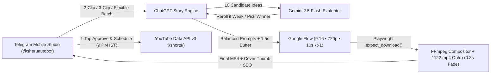

# 🎬 APEX CINEGEN PRO

**Autonomous Multi-Agent AI Cinema Pipeline & Telegram Studio Controller for Viral Vertical Shorts**

[-gold?style=for-the-badge&logo=github)](https://github.com/mehaksandhudev)
[](https://www.python.org/)
[](https://playwright.dev/)
[](https://flow.google.com/)
[](https://ai.google.dev/)
[](https://developers.google.com/youtube/v3)
[](https://t.me/sheruautobot)
[](https://ffmpeg.org/)

---

## 📖 Overview

**APEX CINEGEN PRO** is an end-to-end autonomous video production and publishing engine built for **9:16 YouTube Shorts & Instagram Reels**. It orchestrates **ChatGPT** (dialogue-dense scriptwriting), **Gemini 2.5 Flash** (virality & uniqueness auditing), **Google Flow** (multi-clip AI video generation & timeline extension), **FFmpeg** (local outro compositing with smooth audio fade), **Telegram** (mobile studio remote control with 1-time passkey gating), and **YouTube Data API v3** (automated prime-time scheduling, cover thumbnails, and quote-aware tag packing).

---

## 🎥 Live Video Showcase (2-Clip vs. 3-Clip)

| **2-Clip Fast Short (`~33s` + Outro · Full Audio)** | **3-Clip Epic Short (`~40s` + Outro · Full Audio)** |
| :---: | :---: |
| [](https://www.youtube.com/shorts/-qke-ZRs1ug) | [](https://raw.githubusercontent.com/mehaksandhudev/apex-cinegen-pro/main/assets/demo_3clip_hd.mp4) |
| **Cheetah Builder ki akad 💥 Sheru Bhai ka Flying Pind!** | **Sheru Bhai ka 24K Gold Planet 👑** |
| `Clip 1 (10s)` + `Clip 2 (10s)` + `Outro` | `Clip 1 (10s)` + `Clip 2 (10s)` + `Clip 3 (10s)` + `1122.mp4` |
| [](https://www.youtube.com/shorts/-qke-ZRs1ug) [-2EA44F?style=for-the-badge)](https://raw.githubusercontent.com/mehaksandhudev/apex-cinegen-pro/main/assets/demo_2clip_hd.mp4) | [-2EA44F?style=for-the-badge)](https://raw.githubusercontent.com/mehaksandhudev/apex-cinegen-pro/main/assets/demo_3clip_hd.mp4) |

---

## 🏗️ System Architecture



---

## ✨ Key Features

- **Dual Clip Formats (2-Clip & 3-Clip Modes):**
  - **2-Clip Mode (`20s` + `10s` Outro = `~30s`):** Fast Concept → Delivery pacing with a `1.5s` silent visual breathing buffer in both clips to prevent mid-word cutoffs.
  - **3-Clip Mode (`30s` + `10s` Outro = `~40s`):** Extended 3-act escalation (Hook & Taunt → Viral Power Flex → Grand Crowd Payoff & Mic-Drop).
- **Automated Google Flow Calibration:** Automatically disables **Flow Agent** on fresh projects, switches to **`Omni 1.1 Flash`** (`10s` mode) or max duration slider, and locks **`Video · 720p · 10s · 9:16 · x1`**.
- **Format-Aware Gemini 2.5 Flash Evaluator:** Scores 10 ChatGPT concepts against `used_topics.json` history, triggers dynamic rerolls if concepts are repetitive, and tailors selection to 20s or 30s pacing.
- **Zero-Fail 720p Capture & FFmpeg Compositor:** Uses Playwright `expect_download()` for direct 720p capture, stitches `C:\Users\mehak\Downloads\1122.mp4` with a `0.3s` `afade` audio transition, and extracts Hook/Flex/Punchline thumbnails.
- **Interactive Telegram Studio (`@sheruautobot`):**
  - **1-Time Passkey Gate:** Deep-link auto-unlock (`?start=<YOUR_ACCESS_KEY>`) or `/unlock <key>` stored persistently in `authorized_users.json`, plus `/users` admin view.
  - **Flexible Batch Selector:** Choose `2`, `3`, `5`, `7`, `10`, or `/batch <N>` videos and select 2-Clip or 3-Clip format per batch.
  - **Clean Video-First Delivery:** Dynamic `1/6..6/6` or `1/7..7/7` milestone progress, ending with the playable `.mp4` video and inline actions (**Approve & Schedule**, **View Tags & Info**, **Send Thumbnail & Docs**, **Publish Instantly**).
  - **Live Google Flow Credit Telemetry:** Queries the exact balance, tier, and reset date from Flow's Account Details modal with offline cache fallback.
- **Official YouTube Data API v3 Publisher:** Headless chunked uploads, prime-time `9:00 PM IST` (`15:30 UTC`) scheduling, quote-aware viral tag packing (`480` char safe buffer), custom thumbnails, and direct `https://www.youtube.com/shorts/<ID>` links.

---

## 🛠️ Tech Stack

| Layer | Technology |
| :--- | :--- |
| **Orchestration** | Python 3.11+, Playwright (Chrome DevTools Protocol on `:9222`) |
| **AI Strategy & SEO** | ChatGPT Web Automation + Google Gemini 2.5 Flash REST API |
| **Video Generation** | Google Flow (`Video · 720p · 10s · 9:16 · x1`) |
| **Media Processing** | FFmpeg / FFprobe (`libx264`, `aac`, `afade` 0.3s, frame extraction) |
| **Mobile Control** | Telegram Bot API (pure `requests` + retry + inline keyboards) |
| **Publishing** | YouTube Data API v3 (`google-api-python-client` OAuth 2.0) |

---

## 📁 Project Structure

```text
sheru automation/
├── run_all.py                        # Master autonomous pipeline (--clips 2|3, --batch N, --topic)
├── telegram_bot.py                   # @sheruautobot mobile studio controller & 1-time access gate
├── config.py                         # Prompts (2-Clip & 3-Clip), outro path, keys & configuration
├── gemini_evaluator.py               # Gemini 2.5 Flash topic evaluator & viral metadata generator
├── flow_credits.py                   # Google Flow live credit balance extractor & cache
├── youtube_api.py                    # Official YouTube Data API v3 upload, schedule, stats & tag packer
├── youtube_uploader.py               # Zero-quota Chrome CDP YouTube Studio uploader (fallback)
├── schedule_latest_video.py          # Standalone prime-time YouTube scheduler
├── refresh_youtube_token.py          # YouTube OAuth 2.0 token generator
├── banner.py                         # APEX CINEGEN PRO ASCII terminal banner
├── start_telegram_bot.bat            # 1-click Telegram Studio Bot launcher
├── launch_my_chrome_for_automation.bat # Launches Chrome on CDP port 9222
├── connect_youtube_channel.bat       # 1-click YouTube OAuth linker
├── open_capcut_1122_project.bat      # Quick shortcut to CapCut 1122 draft folder
├── README.md                         # Project documentation
├── CHAT_PROMPTS_AND_FIXES_LOG.md     # Complete prompt & engineering chronicle
├── output_videos/                    # Rendered 30s/40s MP4s, thumbnails & SEO packages
└── tests/                            # Archived test, DOM inspection, and legacy helper scripts
```

---

## 🚀 Installation & Setup

```bash
# 1. Install dependencies
pip install playwright requests google-api-python-client google-auth-oauthlib

# 2. Install Playwright browsers (if needed)
playwright install chromium

# 3. Launch Chrome with Remote Debugging (port 9222) and log into ChatGPT + Google Flow
launch_my_chrome_for_automation.bat

# 4. Connect your YouTube Channel via OAuth 2.0
connect_youtube_channel.bat

# 5. Start the Telegram Studio Controller
start_telegram_bot.bat
```

---

## 📱 Usage

### Telegram Mobile Studio (`@sheruautobot`)
- **Unlock Bot (1-Time):** Open `https://t.me/sheruautobot?start=<YOUR_ACCESS_KEY>` or send `/unlock <YOUR_ACCESS_KEY>`
- **Interactive Menu:** `/menu` — access **Channel Stats**, **Check Credits**, **Generate Story** (`2` or `3` clips), **Batch Mode** (`2/3/5/7/10` videos), **Upload to YouTube**, and **Recent Videos** (stream & approve directly in chat).
- **Direct Commands:** `/generate <topic>`, `/generate 3 <topic>`, `/batch 4`, `/batch 4 3`, `/credits`, `/stats`, `/videos`, `/users`.

### CLI Pipeline
```bash
# Single 2-Clip Short (20s Flow + 1122.mp4 Outro)
python run_all.py --clips 2

# Single 3-Clip Epic Short (30s Flow + 1122.mp4 Outro)
python run_all.py --clips 3

# Batch of 5x 3-Clip Shorts
python run_all.py --batch 5 --clips 3

# Schedule latest generated video for 9:00 PM IST prime-time
python schedule_latest_video.py
```

---

## 📱 Telegram Studio Examples (`@sheruautobot`)

#### A. 1-Time Access Gate (Shareable With Friends)
```text
🔒 APEX CINEGEN PRO — ACCESS GATED
━━━━━━━━━━━━━━━━━━━━
👑 Studio Owner: Mehak Sandhu (@mehaksandhudev)

Please enter your 1-time Studio Access Key to unlock control:
👉 Type: /unlock <YOUR_ACCESS_KEY>  (or use https://t.me/sheruautobot?start=<YOUR_ACCESS_KEY>)
```

#### B. 2-Clip / 3-Clip & Flexible Batch Selection
- Tap **`🎬 Generate Story`** → choose **`2 Clips (20s + Outro)`** or **`3 Clips (30s + Outro)`**
- Tap **`⚡ Batch Mode`** → pick **`2`**, **`3`**, **`5`**, **`7`**, **`10`** *(or `/batch 4`)* → choose **`2 Clips`** or **`3 Clips`**

#### C. Live 7-Step Progress & Video-First Delivery
```text
💡 [Step 1/7] Brainstorming 30s Story & Gemini Evaluation...
🎬 [Step 2/7] Rendering Clip 1 (Google Flow 10s)...
⏱️ [Step 3/7] Extending Clip 2 (10s Extension, Total 20s)...
🎞️ [Step 4/7] Extending Clip 3 (10s Extension, Total 30s)...
⚡ [Step 5/7] 720p Download & Local Outro Stitching...
🖼️ [Step 6/7] Extracting Cover Thumbnails & Viral SEO...
✅ [Step 7/7] All Steps Complete! Sending Your Video...

[ Playable 720x1280 MP4 Video delivered directly in chat ]
[ 🚀 Approve & Schedule (9 PM IST) ] [ 🏷️ View Tags & Info ]
[ 📸 Send Thumbnail & Docs ]        [ 📤 Publish Instantly ]
[ 📹 All Videos ]                   [ 🎬 Generate Another ]
```

#### D. Live Google Flow Credit Telemetry (`/credits`)
```text
💳 GOOGLE FLOW CREDITS TELEMETRY (Live)
━━━━━━━━━━━━━━━━━━━━
• 👤 Account: Mehak Sandhu (mehaksandhudev@gmail.com)
• 💎 Plan: Google Flow PRO Tier
• ⚡ Available Balance: 629 Credits
• 🔄 Next Reset: Dec 7 at 12:46 AM
• 🎬 Estimated Capacity: ~314 full video generations
```

---

## 🤝 Need Help Setting This Up?

Want custom automation, multi-agent AI pipelines, or help setting up **APEX CINEGEN PRO** for your own channel or workflow? Reach out directly:

- **Portfolio:** [mehak-sandhu.in](https://mehak-sandhu.in)
- **Email:** [mehaksandhudev@gmail.com](mailto:mehaksandhudev@gmail.com)
- **GitHub:** [@mehaksandhudev](https://github.com/mehaksandhudev)

---

## 👩‍💻 Author

**Mehak Sandhu**

[](https://mehak-sandhu.in)
[](https://github.com/mehaksandhudev)
[](mailto:mehaksandhudev@gmail.com)

---

## ☕ Support & Sponsor

If this project helped you, consider supporting or sponsoring via [GitHub Sponsors](https://github.com/sponsors/mehaksandhudev), [PayPal](https://paypal.me/mhksandhu), or [Buy Me A Coffee](https://buymeacoffee.com/mehaksandhudev)!

[](https://github.com/sponsors/mehaksandhudev)
[](https://paypal.me/mhksandhu)
[](https://buymeacoffee.com/mehaksandhudev)

---

## 📄 License

Proprietary / Personal Studio Automation — © [Mehak Sandhu](https://mehak-sandhu.in).

---

<div align="center">

Crafted with ❤️ by **[Mehak Sandhu](https://github.com/mehaksandhudev)** • [Portfolio](https://www.mehak-sandhu.in)

</div>
