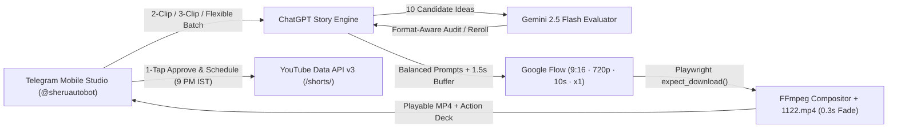

# 🎬 APEX CINEGEN PRO: Autonomous AI Shorts & Cinema Pipeline

[](https://python.org)
[](https://playwright.dev/)
[](https://flow.google.com/)
[](https://ai.google.dev/)
[](https://developers.google.com/youtube/v3)
[](https://t.me/sheruautobot)
[](https://ffmpeg.org/)
[](https://paypal.me/mhksandhu)
[](https://buymeacoffee.com/mehaksandhudev)
[](#-license)

> 🤖 **Zero-Touch AI Cinema Pipeline:** ChatGPT Story Ideation ➔ Gemini 2.5 Flash Virality Audit ➔ Google Flow 10s Multi-Clip Generation ➔ FFmpeg 0.3s Audio Fade & Outro Stitch ➔ Telegram Mobile Studio ➔ YouTube Data API v3 Shorts Scheduling!

An enterprise-grade, end-to-end autonomous **9:16 YouTube Shorts & Instagram Reels** production studio built by **Mehak Sandhu** ([@mehaksandhudev](https://github.com/mehaksandhudev)) for **The Quiet Schema** (`@TheQuietSchema`).

From a single tap in Telegram (`@sheruautobot`) or via CLI, the system brainstorms dialogue-dense comedy concepts in **ChatGPT**, audits originality and format fit with **Gemini 2.5 Flash**, calibrates **Google Flow** (`Video · 720p · 10s · 9:16 · x1`) for 2-clip or 3-clip generation, stitches your custom outro via **FFmpeg** with a smooth `0.3s` audio fade, extracts cover thumbnails + quote-aware SEO tags, delivers the playable MP4 straight to Telegram, and schedules prime-time releases on **YouTube Data API v3**.

---

## 📚 Table of Contents

- [🎬 Live Production Showcase & Demos](#-live-production-showcase--demos)
- [🏗️ System Architecture & 2-Clip vs. 3-Clip Engine](#️-system-architecture--2-clip-vs-3-clip-engine)
- [📱 Telegram Mobile Studio (@sheruautobot)](#-telegram-mobile-studio-sheruautobot)
- [📺 YouTube Data API v3 Publishing](#-youtube-data-api-v3-publishing)
- [📁 Project Structure](#-project-structure)
- [🚀 Quickstart & Setup](#-quickstart--setup)
- [🤖 AI Coding Assistant Context](#-ai-coding-assistant-context)
- [☕ Support & Donations](#-support--donations)
- [🤝 Let's Build Something](#-lets-build-something)
- [📄 Documentation & Session Logs](#-documentation--session-logs)
- [📄 License](#-license)

---

## 🎬 Live Production Showcase & Demos

Real 9:16 vertical Shorts rendered autonomously by **APEX CINEGEN PRO** (with full stereo AAC audio & 24fps H.264 mastering):

| **2-Clip Fast Short (`~33s` + Outro)** | **3-Clip Epic Short (`~40s` + Outro)** |
| :---: | :---: |
| [](https://www.youtube.com/shorts/-qke-ZRs1ug) | [](https://raw.githubusercontent.com/mehaksandhudev/apex-cinegen-pro/main/assets/demo_3clip_hd.mp4) |
| **Cheetah Builder ki akad 💥 Sheru Bhai ka Flying Pind!** | **Sheru Bhai ka 24K Gold Planet 👑** |
| [](https://www.youtube.com/shorts/-qke-ZRs1ug) [-2EA44F?style=flat-square)](https://raw.githubusercontent.com/mehaksandhudev/apex-cinegen-pro/main/assets/demo_2clip_hd.mp4) | [-2EA44F?style=flat-square)](https://raw.githubusercontent.com/mehaksandhudev/apex-cinegen-pro/main/assets/demo_3clip_hd.mp4) |
| *`Clip 1 (10s)` + `Clip 2 (10s)` + `Outro` • `720x1280` `9:16`* | *`Clip 1 (10s)` + `Clip 2 (10s)` + `Clip 3 (10s)` + `1122.mp4` • `720x1280` `9:16`* |

---

## 🏗️ System Architecture & 2-Clip vs. 3-Clip Engine



### Key Production Engineering
- **Dual Format Support (`--clips 2` or `--clips 3`):**
  - **2-Clip Fast Mode (`20s` + Outro):** Balanced **Concept (Clip 1) → Delivery (Clip 2)** pacing (`22–26` words/clip) with a **`1.5s` silent visual breathing buffer** at the end of both clips so AI dialogue never cuts off mid-word.
  - **3-Clip Epic Mode (`30s` + Outro):** 3-act escalation (**Hook & Rival Taunt → Viral Power Flex → Grand Crowd Payoff & Mic-Drop**) with `1.5s` breathing room in all 3 clips.
- **Automated Google Flow Calibration (`Step 3.5`):** Automatically disables **Flow Agent** on fresh projects, selects **`Omni 1.1 Flash`** when `10s` isn't exposed on `Omni 1.2 Flash` (with `.duration-slider` fallback), and locks **`Video · 720p · 10s · 9:16 · x1`**.
- **Format-Aware Gemini 2.5 Flash Evaluator:** Audits 10 candidate ideas against `used_topics.json`, automatically triggers dynamic rerolls on weak/repetitive ideas, and scores specifically for 20s or 30s pacing.
- **Direct 720p Capture & FFmpeg Compositor:** Uses Playwright `expect_download()` for zero-miss 720p capture, stitches `1122.mp4` with a dynamic `0.3s` `afade` audio transition, and extracts Hook/Flex/Punchline cover frames.

---

## 📱 Telegram Mobile Studio (`@sheruautobot`)

Full remote control from phone or desktop with **1-time passkey gating**, live milestone telemetry, and video-first delivery:

| Capability | Details |
| :--- | :--- |
| **🔒 1-Time Access Gate** | Share `https://t.me/sheruautobot?start=<YOUR_ACCESS_KEY>` or send `/unlock <key>`. Permanently authenticates `chat_id` in `authorized_users.json` with `/users` admin inspection. |
| **🎬 2-Clip / 3-Clip Selector** | Tap **`Generate Story`** → pick **`2 Clips (20s + Outro)`** or **`3 Clips (30s + Outro)`** *(or `/generate <topic>` / `/generate 3 <topic>`)*. |
| **⚡ Flexible Batch Mode** | Tap **`Batch Mode`** → pick **`2`**, **`3`**, **`5`**, **`7`**, **`10`** *(or `/batch <N>`)* → choose **`2 Clips`** or **`3 Clips`**. |
| **📊 Live Milestone Progress** | Tracks **`1/6..6/6`** (2-Clip) and **`1/7..7/7`** (3-Clip) steps, delivering the **playable MP4 first** with inline buttons: **`Approve & Schedule (9 PM IST)`**, **`View Tags & Info`**, **`Send Thumbnail & Docs`**, **`Publish Instantly`**. |
| **💳 Live Flow Credit Telemetry** | `/credits` clicks Flow's `[aria-label="Account details"]` modal to report exact credit balance, PRO tier, and reset date (with offline cache fallback). |

---

## 📺 YouTube Data API v3 Publishing

- **Headless OAuth 2.0 (`youtube_api.py`):** Resumable chunked uploads (`MediaFileUpload`), custom cover thumbnail attachment, and automatic `9:00 PM IST` (`15:30 UTC`) scheduling (`publishAt`).
- **Quote-Aware Tag Packing (`pack_youtube_tags_to_limit`):** Packs up to 24+ viral tags safely within YouTube's `480`-char quote-aware buffer.
- **Direct Shorts Linking:** Outputs `https://www.youtube.com/shorts/<ID>` directly so links open in the YouTube Shorts player.
- **Channel Telemetry:** `/stats`, `/top`, and `/comments` query live subscriber count, views, top videos, and audience comments.

---

## 📁 Project Structure

```text
apex-cinegen-pro/
├── run_all.py                          # Master autonomous pipeline (--clips 2|3, --batch N, --topic)
├── telegram_bot.py                     # @sheruautobot mobile studio controller & 1-time access gate
├── config.py                           # .env loader, 2/3-clip prompts, outro path & studio settings
├── gemini_evaluator.py                 # Gemini 2.5 Flash topic evaluator & viral SEO generator
├── flow_credits.py                     # Google Flow live credit balance extractor & cache
├── youtube_api.py                      # Official YouTube Data API v3 upload, schedule, stats & tag packer
├── youtube_uploader.py                 # Zero-quota Chrome CDP YouTube Studio uploader (fallback)
├── schedule_latest_video.py            # Standalone prime-time YouTube scheduler
├── refresh_youtube_token.py            # YouTube OAuth 2.0 token generator
├── banner.py                           # APEX CINEGEN PRO ASCII terminal banner
├── start_telegram_bot.bat              # 1-click Telegram Studio Bot launcher
├── launch_my_chrome_for_automation.bat # Launches Chrome on CDP port 9222
├── connect_youtube_channel.bat         # 1-click YouTube OAuth linker
├── open_capcut_1122_project.bat        # Quick shortcut to CapCut 1122 draft folder
├── .env.example                        # Environment configuration template (no secrets)
├── assets/                             # Compressed 24fps <10MB showcase MP4s with full audio
├── output_videos/                      # Rendered MP4s, thumbnails & SEO metadata packages
└── tests/                              # Archived test, DOM inspection & legacy helper scripts
```

---

## 🚀 Quickstart & Setup

```bash
# 1. Clone and enter project
git clone https://github.com/mehaksandhudev/apex-cinegen-pro.git
cd apex-cinegen-pro

# 2. Install Python dependencies
pip install playwright requests google-api-python-client google-auth-oauthlib
playwright install chromium

# 3. Configure environment secrets (never commit .env)
copy .env.example .env
# Edit .env with your GEMINI_API_KEY, TELEGRAM_BOT_TOKEN, and STUDIO_ACCESS_KEY

# 4. Launch Chrome with Remote Debugging (port 9222) and log into ChatGPT + Google Flow
launch_my_chrome_for_automation.bat

# 5. Link your YouTube Channel via OAuth 2.0 (requires client_secrets.json)
connect_youtube_channel.bat

# 6. Start the Telegram Studio Controller
start_telegram_bot.bat
```

### CLI Examples
```bash
python run_all.py --clips 2              # Single 2-Clip Short (20s Flow + Outro)
python run_all.py --clips 3              # Single 3-Clip Epic Short (30s Flow + Outro)
python run_all.py --batch 5 --clips 3    # Batch of 5x 3-Clip Epic Shorts
python schedule_latest_video.py          # Schedule latest MP4 for 9:00 PM IST prime-time
```

---

## 🤖 AI Coding Assistant Context

If you are using an AI Coding Assistant (*Google Antigravity, Claude Code, Cursor, Windsurf, or GitHub Copilot*), paste this prompt for instant architectural context:

```text
You are working on 'APEX CINEGEN PRO' created by Mehak Sandhu (@mehaksandhudev) at https://github.com/mehaksandhudev/apex-cinegen-pro.

MANDATORY FIRST STEP:
Read README.md, CHAT_PROMPTS_AND_FIXES_LOG.md, and config.py before modifying any files.

CORE ARCHITECTURAL RULES:
1. Branding: Project is 'APEX CINEGEN PRO' by Mehak Sandhu (@mehaksandhudev).
2. Dual Clip Modes: Support both 2-Clip (MASTER_PROMPT_TEMPLATE) and 3-Clip (MASTER_PROMPT_TEMPLATE_3CLIPS) via --clips 2|3, keeping 1.5s silent visual breathing buffers at the end of every clip.
3. Flow Calibration: Step 3.5 in run_all.py must disable Flow Agent if active and lock Video · 720p · 10s · 9:16 · x1 (switching to Omni 1.1 Flash if 10s isn't shown, with slider fallback).
4. FFmpeg Outro: Stitch C:\Users\mehak\Downloads\1122.mp4 with a 0.3s afade audio fade-out.
5. Telegram Bot: telegram_bot.py enforces 1-time passkey gating (authorized_users.json), dynamic 6/7-step progress, and delivers the playable MP4 first with inline Approve/Tags/Thumbnail/Publish buttons.
6. Secret Safety: NEVER commit .env, client_secrets.json, youtube_token.pickle, authorized_users.json, or chrome_profile/.
```

---

## ☕ Support & Donations

If this automation pipeline helped your YouTube channel or workflow, consider supporting via [PayPal](https://paypal.me/mhksandhu), [Buy Me A Coffee](https://buymeacoffee.com/mehaksandhudev), or [GitHub Sponsors](https://github.com/sponsors/mehaksandhudev):

[](https://github.com/sponsors/mehaksandhudev)
[](https://paypal.me/mhksandhu)
[](https://buymeacoffee.com/mehaksandhudev)

---

## 🤝 Let's Build Something

<div align="center">

I'm available for **custom automation setups**, **multi-agent AI pipelines**, and **freelance engineering**.

If you want help setting up **APEX CINEGEN PRO** or building a custom production system, let's connect!

<br/>

[](https://www.mehak-sandhu.in)
[](mailto:mehaksandhudev@gmail.com)
[](https://github.com/mehaksandhudev)

</div>

---

## 📄 Documentation & Session Logs

- 📜 **[CHAT_PROMPTS_AND_FIXES_LOG.md](CHAT_PROMPTS_AND_FIXES_LOG.md)**: Complete chronological engineering log, prompt iterations, and fixes.
- ⚙️ **[.env.example](.env.example)**: Environment variable template (zero secrets).

---

## 📄 License

Proprietary / Personal Studio Automation — © [Mehak Sandhu](https://mehak-sandhu.in).

---

<div align="center">


<sub>⚡ Automation Architect · Crafted with ❤️ by <a href="https://github.com/mehaksandhudev"><strong>Mehak Sandhu</strong></a> · <a href="https://www.mehak-sandhu.in">mehak-sandhu.in</a></sub>

</div>
