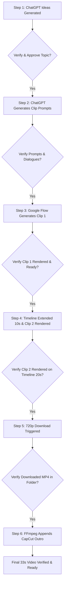

# Sheru Bhai Automation - Session Log & Prompt Archive
**Date:** November 22-23, 2026  
**Status:** All pipeline components verified & 3 complete 33s videos generated with outro.

---

## 1. Master Prompt Template (Current & Active in `config.py`)

```text
[VIDEO DURATION: 20 SECONDS] <-- (20 SECONDS = 2 clips: Clip 1 and Clip 2)
Act as an elite viral YouTube Shorts & Instagram Reels director specializing in fast-paced, hyper-realistic Indian "Sheru Bhai" comedy and motivational-revenge videos.

Follow these strict rules in 2 phases:

### PHASE 1: GENERATE 10 VIRAL STORY IDEAS
Give me a clean numbered list of 10 wildly creative, hilarious, and unexpected "Sheru Bhai" story ideas.
You have complete creative independence: invent funny animal rivals (like Crocodile Don, Cheetah Builder, Shark Seth, Bhaloo Mayor, etc.), absurd Indian luxury flexes, auction wars, or wild comedy revenge confrontations featuring Sheru Bhai (the billionaire white-suited anthropomorphic lion with heavy gold chains and dark sunglasses).
Make each idea fresh, high-energy, and uniquely funny.
Keep each idea to 1 catchy title + 1 short line.
STOP after listing the 10 ideas and ask ONLY: "Which topic number (1–10) do you want to generate?"

### PHASE 2: OUTPUT CLEAN, ZERO-GAP GOOGLE FLOW PROMPTS
Once I reply with a topic number, DO NOT write any intro, separate scripts, or character lists.
Output EXACTLY 2 separate 10-second prompts (Clip 1 (0:00–0:10) and Clip 2 (0:10–0:20)).
Put each prompt inside its own separate copy-paste code block.

CRITICAL RULES FOR MAXIMUM DIALOGUE DENSITY & ZERO-BOREDOM PACING:
1. Dialogue-Packed Banter Across the Entire 10 Seconds (Zero Silent Gaps):
   - Both clips must have dialogue spanning continuously across the entire 10 seconds with rapid back-and-forth verbal exchanges so the audience is hooked every single second without feeling bored:
   - Clip 1 (0:00–0:10):
     - Starts at 0.0s immediately: The arrogant animal rival taunts Sheru with an elaborate, hilarious Hindi insult (e.g., "Arre Sheru, teri aukaat sirf purana scooter chalane ki hai...").
     - At 0:04s: The auctioneer/crowd loudly reacts in dialogue ("Arre baap re, itna bada challenge!").
     - At 0:07s–0:10s: Sheru delivers a sharp verbal warning with burning intensity ("Sheru se panga lene ki galti kar di, ab dekh tera kya haal hota hai!").
   - Clip 2 (0:10–0:20):
     - Starts at 0:10s immediately: Sheru roars back with extreme swag, delivering a breathless rapid-fire power flex that MUST include the signature comedic words: "Oye chup! Million, billion, trillion, quadrillion, gazillion, ghop ghop..." with boss hand gestures.
     - At 0:15s: The auctioneer screams the historic win ("Bik gaya! Sheru Bhai ne poora maidaan khareed liya!"), while the rival gasps in disbelief.
     - At 0:17s–0:20s: Sheru delivers a triumphant witty final punchline while comfortably flexing his prize with boss swagger.
2. Dialogue Authenticity:
   - Rival and side characters speak natural, grounded, funny Hindi/Hinglish.
   - ONLY Sheru delivers the iconic rapid-fire "million, billion, trillion, gazillion, ghop ghop..." power flex.
3. Hyper-Realistic Visual Continuity:
   - Every prompt must include: photorealistic 8K live-action cinema, shot on ARRI Alexa, real individual fur strands, natural skin textures, fast whip-pans and crash-zooms, 9:16 vertical, shallow depth of field, maintaining the exact same venue, characters, and outfits across both clips.
   - Start Clip 2 explicitly with: "Continuing seamlessly from the exact last frame of the previous clip..."

Start now with Phase 1 and list the 10 ideas.
```

---

## 2. Prompts & Responses Generated in Tonight's Session

### Video 1: "Sheru Bhai vs Rhino Raja: Bullet Train Tractor Race"
- **Status:** Rendered, 720p downloaded & merged with CapCut Outro.
- **Output File:** `output_videos/sheru_tractor_race_final.mp4` / `output_videos/sheru_final_complete.mp4`
- **Total Duration:** 33.01 seconds

#### Clip 1 Prompt (0:00–0:10):
```text
10-second ultra-fast, hyper-realistic Indian cinematic comedy. 9:16 vertical video. Photorealistic 8K live-action cinema, shot on ARRI Alexa, real individual fur strands, natural skin textures, fast whip-pans and crash-zooms, shallow depth of field, realistic motion blur.

SETTING: A dusty, high-octane luxury tractor-racing arena in rural Punjab styled as a multi-million-dollar grand prix with golden barricades, roaring crowd, dynamic afternoon sun and stadium lights. Maintain this exact venue throughout both clips.

CHARACTERS: Sheru Bhai — massive anthropomorphic lion in a spotless tailored white three-piece suit, heavy 24K gold chains, black silk shirt, gold Rolex and dark sunglasses. Arrogant animal rival Rhino Raja — muscular anthropomorphic rhino in an open red velvet designer jacket, diamond necklaces, standing arrogantly beside a diamond-encrusted monster tractor. Energetic human-like bull auctioneer with a golden mic.

0.0–4.0s: Immediate fast push-in on Rhino Raja laughing loudly, pointing a gold wrench at Sheru’s old rusty scooter.
RHINO RAJA (mocking Hindi/Punjabi): "Oye Sheru! Aukaat teri khet vich tiddi maran di nahi, te bullet train tractor naal race karenga? Bhaj jaa ethon!"

4.0–7.0s: Whip-pan to the bull auctioneer waving the green flag, crowd cheering in shock.
AUCTIONEER: "Arre baap re! Rhino Raja ne lalkaara ditta! Sheru Bhai di izzat da sawaal hai ji!"

7.0–10.0s: Crash-zoom onto Sheru’s furious, cool face, adjusting his sunglasses as his golden mane blows in the wind.
SHERU BHAI (deep menacing roar): "Rhino, race ch gaadi nahi, jigra vekhya jaanda hai... hun vekh Sheru ki flex karda!"

Continuous rapid Hindi/Punjabi dialogue from 0.0s to 10.0s. No silent gaps. Intense cinematic sound design, roaring tractor engines, crowd cheering. Seamless continuity into Clip 2.
```

#### Clip 2 Prompt (0:10–0:20):
```text
Continuing seamlessly from the exact last frame of the previous clip... 10-second ultra-fast, hyper-realistic Indian cinematic comedy. 9:16 vertical video. Photorealistic 8K live-action cinema, shot on ARRI Alexa, real individual fur strands, natural skin textures, fast whip-pans and crash-zooms, shallow depth of field, realistic motion blur.

STRICT CONTINUITY: Same luxury tractor-racing arena, same crowd, same afternoon lighting, same dusty track. Sheru Bhai is the identical massive white lion in a white suit, gold chains, black shirt, gold watch and dark sunglasses. Rhino Raja is the identical rhino in his red velvet suit, diamond necklaces and sunglasses beside his diamond tractor. Sheru now stands next to an outrageous rocket-powered golden tractor with spinning jet turbines, a DJ booth and wedding lights mounted on it.

0.0–4.5s: Sheru points at Rhino, then at the golden rocket tractor, rapidly waving his boss hand and flexing his gold chains.
SHERU BHAI (rapid-fire swag): "Oye chup! Million, billion, trillion, quadrillion, gazillion, ghop ghop! Tera tractor khareed ke ispe DJ te baraat vi laa ditti!"

4.5–7.0s: Auctioneer jumps on the stage screaming, crowd explodes, Rhino's jaw drops.
AUCTIONEER: "Bik gaya! Rocket tractor Sheru Bhai da! Rhino Raja di saari izzat auction ch udd gayi!"
RHINO RAJA: "Hain?! Eh tractor vi khareed lya?!"

7.0–10.0s: Sheru sits on the rocket tractor, revs it, golden turbines blast, wedding DJ plays, tractor launches forward with the crowd dancing.
SHERU BHAI (laughing): "Rhino, hun teri race nahi... meri baraat chalni aa! Side ho ja, oye!"

No silent gaps. Continuous dialogue and crowd reactions. Wild visual payoff, rapid cuts, aggressive camera energy, realistic dust and turbine effects, hilarious luxury flex, cinematic final frame with Sheru flying past Rhino while the wedding baraat dances.
```

---

### Video 2: "Sheru Bhai vs Python Banker: The Moon ATM"
- **Status:** Rendered, 720p downloaded & merged with CapCut Outro.
- **Output File:** `output_videos/sheru_moon_atm_final.mp4`
- **Total Duration:** 33.01 seconds

#### Clip 1 Prompt (0:00–0:10):
```text
10-second ultra-cinematic hyper-realistic Indian comedy scene. 9:16 vertical, photorealistic 8K live-action cinema, shot on ARRI Alexa, real individual fur strands, natural skin textures, shallow depth of field, fast whip-pans and crash-zooms, realistic lighting, explosive crowd energy.

SETTING: A massive luxury auction hall styled like a futuristic Indian billionaire bank, giant golden ATM glowing with a MOON hologram, stacks of cash, chandeliers, VIP crowd, cinematic smoke. Maintain this exact venue throughout both clips.

CHARACTERS: Sheru Bhai — massive white-maned lion in an immaculate white three-piece suit, diamond sunglasses, thick gold chains, cigar in mouth. Python Banker — sleek, emerald-scaled anthropomorphic python in an opulent green velvet waistcoat, gold monocle, holding a diamond calculator. Bull Auctioneer with a golden gavel.

0:00–0:04 — Python slithers forward, tapping his calculator arrogantly, pointing and laughing at Sheru.
PYTHON: "Arre Sheru, tera account toh minus mein chal raha hai! Chaand ka pehla ATM khareedne ki aukaat sirf Python Bank ki hai!"

0:04–0:07 — Bull auctioneer raises the gavel, crowd gasps and whispers in shock.
AUCTIONEER: "Sau arab rupaye ki boli! Kya Sheru Bhai chup baithenge?!"

0:07–0:10 — Sheru takes off his sunglasses, his golden eyes burning with menacing swag, adjusting his Rolex.
SHERU BHAI: "Python, bank tera hoga... par poora chaand Sheru Bhai cash mein khareedega!"

Fast-paced, high tension, overlapping dialogue starting immediately at 0.0s, authentic Hindi accents, zero pauses, cinematic brass music sting at the end.
```

#### Clip 2 Prompt (0:10–0:20):
```text
Continuing seamlessly from the exact last frame of the previous clip... 10-second ultra-cinematic hyper-realistic Indian comedy scene. 9:16 vertical, photorealistic 8K live-action cinema, shot on ARRI Alexa, real individual fur strands, natural skin textures, shallow depth of field, fast whip-pans and crash-zooms, realistic lighting. SAME auction hall, SAME lighting, SAME characters, SAME outfits, exact visual continuity.

0:10–0:15 — Sheru instantly slams his gold-studded hand on the bidding desk, stands with boss swagger, points at the Moon ATM hologram, and rapid-fires: "Oye chup! Million, billion, trillion, quadrillion, gazillion, ghop ghop! Chand kya, poori galaxy cash mein le lo! Upar mera ATM, neeche meri dukaan!" Python's jaw drops, eyes bulge, audience goes wild.

0:15–0:17 — Auctioneer screams, voice cracking: "Bik gaya! Bik gaya! Sheru Bhai ne chaand ka ATM khareed liya! Itihas badal gaya bhai!" Python gasps: "Mera bank... bankrupt?!"

0:17–0:20 — Sheru lounges on a massive golden throne beside a miniature Moon ATM trophy, tosses a gold coin into the air and catches it, smirking: "Python, ab tere bank ka interest chaand pe bharna... cash nahi, cheese mein!" He laughs, crowd explodes, Python faints backward into a pile of money.

Rapid continuous dialogue, zero silent gaps, hilarious reaction timing, authentic Indian auction crowd chaos, perfect lip sync, dramatic cinematic ending with a golden lunar ATM flashing behind Sheru.
```

---

### Video 3: "The 24K Gold Cricket Stadium 🏏"
- **Status:** Rendered & merged.
- **Output File:** `output_videos/sheru_cricket_stadium_30s.mp4`
- **Total Duration:** 30.00 seconds

---

## 3. Tomorrow's Plan: Step-by-Step Verification Gates

Tomorrow, we will upgrade `run_all.py` with an **interactive step-by-step verification mode** (`--interactive` or default):



### Planned Verification Checks:
1. **Gate 1 (Idea & Topic):** Prompt terminal/user: show selected winning topic, ask confirmation before requesting full prompts.
2. **Gate 2 (Prompt Check):** Verify both prompts have >1,000 characters and contain dialogues and signature `"ghop ghop"` line.
3. **Gate 3 (Clip 1 Render):** Take a screenshot or check timeline to confirm Clip 1 has rendered before touching the timeline.
4. **Gate 4 (Extend 10s):** Verify timeline duration expanded to 00:20:00 before submitting Clip 2.
5. **Gate 5 (Download):** Verify file appeared in Downloads and duration equals 20s.
6. **Gate 6 (Final Merge):** Verify final file duration equals 33s and video plays seamlessly.
